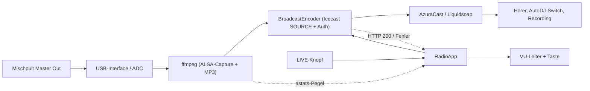
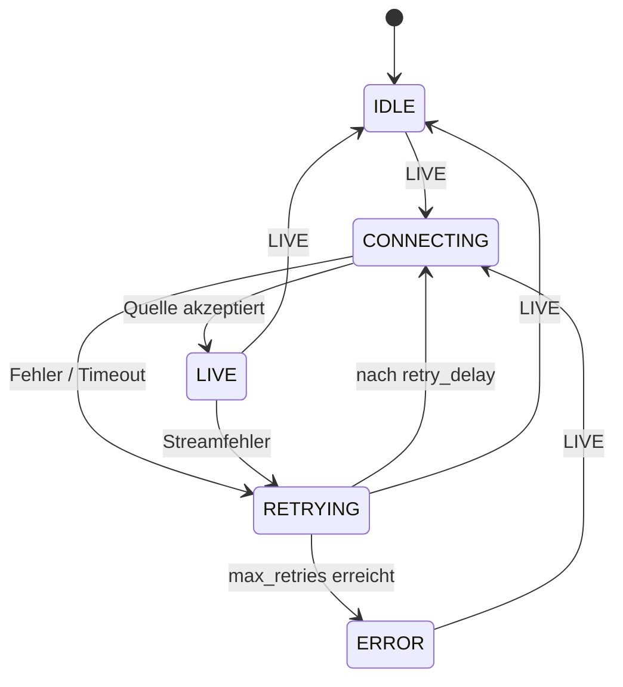

# Castcorder — Live-DJ-Tapedeck

Ein Raspberry Pi im Tapedeck-Gehäuse: Mischpult-Master-out rein, **LIVE** drücken,
und das Castcorder geht als deine DJ-Identity auf
[radio.zukkafabrik.de](https://radio.zukkafabrik.de) on air. Nochmal drücken →
zurück zum AutoDJ.

Das Castcorder ist ein eigenständiger **Icecast-Source-Encoder** für AzuraCast.
Er verbindet sich direkt mit Liquidsoap auf dem DJ-Port, den AzuraCast dir für
deinen Streamer-Account zeigt.

Projektseite mit Gehäuse-Konzepten: <https://momokli.github.io/castcorder/>

```
Mischpult Master Out
        │  Line/RCA
        ▼
USB-Audio-Interface / ADC-HAT     ← Line-In/ADC
        │  ALSA
        ▼
Raspberry Pi: ffmpeg (MP3 192k) + castcorder
        │  Icecast SOURCE + Basic Auth
        ▼
AzuraCast / Liquidsoap  ──►  AutoDJ-Switch, Hörer, Recording, Telegram-Pipeline
```

## Was er kann

- **Ein Knopf, zwei Zustände:** LIVE senden / stoppen.
- **DJ-Identity:** verbindet mit dem konfigurierten Streamer-Account
  (`username` + Passwort aus einer Secret-Datei), nicht mit dem Admin-Account.
- **VU-Leiter unter dem Cassettenfenster:** der Eingangspegel wird in Echtzeit über
  sieben Segmente angezeigt; bei 0 dBFS leuchtet die ganze Leiter
  (Clipping-Warnung).
- **Sicheres Passwort:** steht nur in `/etc/castcorder/streamer.env`
  (`0600`, root); es landet nicht in der TOML, nicht im Repo und nicht in `ps`.
- **Robust:** Verbindungsfehler werden automatisch mit Delay neu versucht;
  ein zweiter Druck bricht den Retry ab.
- **Autostart:** systemd-Service; der Encoder startet erst beim Knopfdruck.
- **Passt zu deiner bestehenden Pipeline:** AzuraCast sieht einen normalen
  Live-DJ und feuert `live_connect`/`live_disconnect`-Webhooks aus. Telegram,
  Recording und Funkwhale-Upload laufen wie bei BUTT/Mixxx.

## LED-Verhalten

| Zustand      | VU-Leiter                                         | LIVE-Taste     |
| ------------ | ------------------------------------------------- | -------------- |
| `idle`       | aus                                               | glimmt schwach |
| `connecting` | läuft 1 → 7 durch                                 | blinkt         |
| `live`       | Eingangspegel als Leiter 0–7, alle 7 bei Clipping | an             |
| `retrying`   | alle blinken langsam                              | aus            |
| `error`      | alle blinken schnell                              | aus            |

## Hardware

Die ausführliche Stückliste, Pegel-/ADC-Erklärung, Pinbelegung und Gehäuse-Ideen
stehen in **[docs/hardware.md](docs/hardware.md)**.

Kurzfassung:

| Teil          | Empfehlung                                                                       |
| ------------- | -------------------------------------------------------------------------------- |
| Pi            | Raspberry Pi 4/5 (Zero 2 W geht, ist aber knapp für USB + Encoding)              |
| Audio-Eingang | USB-Audio-Interface mit Stereo-Line-In (z. B. Behringer UCA202/222) oder ADC-HAT |
| Knopf         | 16-mm-Taster „LIVE“, beleuchtet (3,3-V-LED)                                      |
| VU-Leiter     | 7 × 5-mm-LED + 220–330 Ω                                                         |
| Strom         | offizielles 5-V-Netzteil (Pi 4: 3 A, Pi 5: 5 A, Zero 2 W: 2,5 A)                 |
| Gehäuse       | Tapedeck ~220 × 140 × 60 mm mit Ausschnitt für Line-In/Button                    |

**Wichtig:** Der Pi hat keinen Line-In. Benötigt wird ein Audio-Eingang
(ADC/Line-In) vom Mischpult. Das Pi-3,5-mm-Jack ist nur Ausgang.
I2S-Pins 18–21 bleiben für einen ADC-HAT reserviert; die Beispiel-Leiter nutzt
deshalb BCM5, 6, 16, 22, 23, 24, 25 und den Knopf auf BCM17.

## AzuraCast vorbereiten

1. In AzuraCast als Admin einloggen.
2. Station **radio zukka** → **Streamers/DJs** → deinen DJ-Account öffnen
   (z. B. `momo`). Der Account muss aktiv sein.
3. Im Abschnitt **Connection Information → Icecast Clients** diese Werte
   kopieren:
   - **Server** (z. B. `cast.zukkafabrik.de`)
   - **Port** (typisch `8005`, aber exakt den Wert von der Seite nehmen)
   - **Mount Name** (typisch `/`; exakt übernehmen)
   - **Username** (DJ-/Streamer-Benutzername)
   - **Password** (nur in die Secret-Datei, nie ins Repo)

Das Castcorder verbindet sich auf diesen Port direkt mit Liquidsoap. Das ist ein
anderer Port als der öffentliche Hörer-Stream (`/listen/radio/radio.mp3`).
Der Port muss von deinem Pi aus erreichbar sein (Firewall); ein
Cloudflare-/Reverse-Proxy davor blockiert Source-Verbindungen meist.

## Schnellstart auf dem Pi

Voraussetzungen: Raspberry Pi OS Lite (Bookworm oder neuer), Netzwerk,
USB-Interface/ADC eingesteckt, DJ-Account in AzuraCast vorhanden.

```bash
# Repo-URL ggf. anpassen bzw. den Projektordner per scp auf den Pi kopieren
git clone https://github.com/momokli/castcorder.git
cd castcorder

sudo ./deploy/install.sh

# 1) Verbindungsdaten eintragen
sudo nano /etc/castcorder/config.toml

# 2) Streamer-Passwort eintragen (Datei ist 0600, root)
sudo nano /etc/castcorder/streamer.env

sudo systemctl restart castcorder
journalctl -u castcorder -f
```

Das Installationsskript installiert `ffmpeg`, `alsa-utils`, `gpiozero` und
`lgpio`, legt den Systembenutzer `castcorder` an, kopiert die Software und aktiviert
den Service. Es legt außerdem `config.toml` und `streamer.env` an, falls sie
noch nicht existieren.

### Eingang prüfen

```bash
arecord -l
# Beispiel: card 1: Device [USB Audio Device], device 0: USB Audio [USB Audio]
```

In `config.toml` als `[input] device` z. B. eintragen:

```toml
[input]
device = "plughw:CARD=Device,DEV=0"
sample_rate = 44100
channels = 2
```

`plughw:` ist robuster als `hw:` (automatische Konvertierung). Danach den
Eingangspegel testen:

```bash
ffmpeg -hide_banner -f alsa -i plughw:CARD=Device,DEV=0 -t 5 \
  -af astats -f null -
```

Die `Peak level dB`-Zeile sollte bei laufender Musik etwa zwischen −20 und
−6 dBFS liegen. Clipping vermeiden: Master am Mischpult etwas runter, bei
Bedarf DI/Attenuator verwenden.

### Alles prüfen

```bash
sudo bash -c 'set -a; . /etc/castcorder/streamer.env; set +a; \
  cd /opt/castcorder; \
  exec /usr/bin/python3 -m castcorder \
    --config /etc/castcorder/config.toml --check'
```

Der Check zeigt Konfiguration, Board, ffmpeg-Version, Capture-Geräte,
Streamer-Passwort-Status und ob `gpiozero` vorhanden ist.

## Konfiguration

Vollständige Datei: [`config.example.toml`](config.example.toml).

| Abschnitt    | Schlüssel                             | Bedeutung                                                            |
| ------------ | ------------------------------------- | -------------------------------------------------------------------- |
| `[input]`    | `device`                              | ALSA-Capture-Gerät, z. B. `plughw:CARD=Device,DEV=0`                 |
|              | `sample_rate`                         | 44100 (AzuraCast-Station: 44,1 kHz)                                  |
|              | `channels`                            | 1 oder 2 (Mischpult: 2)                                              |
|              | `extra_args`                          | zusätzliche ffmpeg-Input-Argumente (selten nötig)                    |
| `[stream]`   | `host`                                | AzuraCast-Server aus „Icecast Clients“                               |
|              | `port`                                | DJ-/Source-Port aus „Icecast Clients“ (typisch 8005)                 |
|              | `mount`                               | Mount Name aus der Seite (typisch `/`)                               |
|              | `username`                            | Streamer-/DJ-Benutzername                                            |
|              | `password_env`                        | Name der Umgebungsvariable (Standard `CASTCORDER_STREAMER_PASSWORD`) |
|              | `tls`                                 | `true` nur, wenn dein Source-Port TLS spricht                        |
|              | `name`, `description`, `genre`, `url` | optionale Icecast-Header                                             |
|              | `public`                              | `Ice-Public`-Flag (meist `false`)                                    |
| `[encoder]`  | `bitrate`                             | MP3-Bitrate in kbps (Station: 192)                                   |
|              | `extra_args`                          | zusätzliche ffmpeg-Output-Argumente                                  |
| `[leds]`     | `vu`                                  | Pegelanzeige auf der VU-Leiter an/aus                                |
|              | `vu_min_db`, `vu_max_db`              | dBFS-Bereich, der auf 0–7 Segmente abgebildet wird                   |
|              | `vu_decay_per_second`                 | Abfallgeschwindigkeit der Pegelanzeige                               |
| `[gpio]`     | `button_pin`                          | BCM-Pin des LIVE-Tasters (gegen GND)                                 |
|              | `button_led_pin`                      | BCM-Pin der Taster-Beleuchtung, weglassen = aus                      |
|              | `button_active_high`                  | `true`, wenn der Taster gegen 3V3 schaltet                           |
|              | `button_bounce_time`                  | Entprellzeit in Sekunden                                             |
|              | `vu_leds`                             | genau 7 BCM-Pins in Reihenfolge `vu1…vu7`; `[]` = keine LEDs         |
| `[behavior]` | `connect_timeout_seconds`             | Timeout für ffmpeg-Start + Icecast-Login                             |
|              | `retry_delay_seconds`                 | Pause zwischen Reconnects                                            |
|              | `max_retries`                         | automatische Reconnects nach einem Fehler                            |
|              | `min_connecting_display_seconds`      | Mindestdauer der Verbindungs-Animation                               |

Die Konfiguration wird strikt validiert: Tippfehler in Schlüsselnamen,
doppelt belegte Pins, ungültige Ports oder ein fehlender Benutzername führen zu
einer klaren Fehlermeldung im Journal, statt still auf Defaults zurückzufallen.

### Passwort / Secret

`/etc/castcorder/streamer.env`:

```dotenv
CASTCORDER_STREAMER_PASSWORD=dein-streamer-passwort
```

- Datei bleibt `root:root 0600`.
- systemd liest sie als PID 1, bevor der Prozess auf `castcorder` wechselt.
- Bei Leerzeichen, `#` oder `$` im Passwort den Wert in doppelte Anführungszeichen
  setzen (systemd-`EnvironmentFile`-Syntax):
  `CASTCORDER_STREAMER_PASSWORD="mein passwort"`.
- Das Passwort wird nur im Speicher des Python-Prozesses verwendet und als
  `Authorization: Basic …`-Header gesendet. Es steht **nicht** in der
  ffmpeg-Kommandozeile und damit nicht in `ps`.
- `password_env` in `config.toml` kann auf einen anderen Variablennamen zeigen.

## Wie es funktioniert





- `ffmpeg` liest den ALSA-Eingang, wandelt nach Stereo/44,1 kHz und encodiert
  MP3 192 kbps CBR nach stdout.
- Das Castcorder sendet selbst `SOURCE <mount> HTTP/1.0` mit Basic Auth an
  AzuraCast/Liquidsoap. Das ist wichtig, weil ffmpegs eingebauter
  `icecast://`-Client den bei AzuraCast üblichen Mountpoint `/` ablehnt.
- Erst nach den ersten echten MP3-Daten wird die Quelle angemeldet und `LIVE`
  angezeigt – ein falsches Eingabegerät löst also keinen Live-Webhook aus.
- `astats` im ffmpeg-Filter liefert Peak-dBFS-Werte; `RadioApp` bildet sie auf
  die VU-Leiter ab.
- `RadioApp` ist frei von GPIO-, ffmpeg- und Icecast-Details und wird mit Fakes
  getestet.

## Entwicklung & Tests

Die Testsuite braucht weder Pi noch ALSA noch Netzwerk:

```bash
python3 --version        # 3.11+
python3 -m unittest discover -s tests -v
```

Getestet wird unter anderem:

- Konfigurationsparsing/-validierung und Secret-Handling
- Icecast-Source-Protokoll gegen einen lokalen Fake-Server
  (Mount `/`, Basic Auth, 200/401/100-Continue)
- ffmpeg-Kommando, `astats`-Pegelparser
- Encoder-Lebenszyklus mit Fake-ffmpeg (Start, Pegel, Stop, Fehler)
- komplette Zustandsmaschine inkl. Retries, Timeout, VU-Decay

Ein Live-Test ist nur auf dem Pi mit echtem Audio-Interface und echtem
AzuraCast-Account möglich. Auf dem Pi kannst du die Software auch ohne
LEDs/Taster starten; Enter simuliert dann den LIVE-Knopf:

```bash
sudo bash -c 'set -a; . /etc/castcorder/streamer.env; set +a; \
  cd /opt/castcorder; \
  exec /usr/bin/python3 -m castcorder \
    --config /etc/castcorder/config.toml --no-gpio'
```

## Fehlersuche

| Symptom                                  | Ursache / Lösung                                                                                                 |
| ---------------------------------------- | ---------------------------------------------------------------------------------------------------------------- |
| `arecord -l` zeigt kein Gerät            | USB-Interface nicht erkannt; `dmesg`, anderes Kabel/Port, bei Zero 2 W OTG-Adapter/Hub und genug Strom           |
| `Device or resource busy`                | Ein anderer Prozess (PulseAudio, `arecord`, alte ffmpeg-Instanz) hält das Capture-Gerät                          |
| Kein Pegel / Leiter bleibt aus           | `alsamixer` Capture-Gain, Mischpult-Master, falsches `[input] device`; `ffmpeg … -af astats -f null -` testen    |
| Leiter immer alle 7                      | Eingang clippt; Master runter oder Attenuator/DI; `vu_max_db` ggf. anpassen                                      |
| `401 Unauthorized` / „Quelle abgelehnt“  | Falscher DJ-Username/Passwort, Account deaktiviert, falscher Port/Mount                                          |
| `403 Forbidden` / „mountpoint occupied“  | Es sendet schon ein anderer DJ/Client auf diesen Mount                                                           |
| Login-Timeout                            | Firewall blockt DJ-Port, falscher Host, `tls` falsch, Cloudflare davor                                           |
| Service startet nicht (Exit 2/3)         | Konfiguration/Passwort/GPIO fehlerhaft; `RestartPreventExitStatus=2 3` verhindert Endlos-Restarts; Journal lesen |
| `Permission denied` auf `/dev/gpiochip0` | `castcorder` in `gpio`-Gruppe; Service hat `SupplementaryGroups=audio gpio`                                      |
| `GPIO busy`                              | Anderer Dienst nutzt den Pin; VU-Leiter/Button-Belegung prüfen                                                   |
| Knopf reagiert nicht                     | Bei Schaltung gegen 3V3: `button_active_high = true`; `--check` nutzen                                           |
| AzuraCast zeigt live, aber keine Musik   | Mischpult-Kanal stumm/Input falsch; das Castcorder sendet ggf. Stille                                            |
| Telegram/Recording fehlt                 | Das macht deine bestehende Recording-Pipeline; das Castcorder liefert nur die Live-Quelle                        |
| Nach Netzabbruch kein Stream             | Das Castcorder retried automatisch; die Leiter blinkt währenddessen                                              |

## Sicherheit

- Kein Passwort in `config.toml`, im Repo oder in der Kommandozeile.
- `streamer.env` ist `0600 root:root`; der Service liest sie über systemd.
- Nur den DJ-/Streamer-Account verwenden, nie den Admin-Account.
- Passwort bei Verdacht rotieren: in AzuraCast ändern, `streamer.env` anpassen,
  `sudo systemctl restart castcorder`.
- Das Passwort nicht in Chat/Logs posten; `--check` zeigt nur „gesetzt/FEHLT“.

## Projektstruktur

```
castcorder/
├── castcorder/           # Python-Paket (keine pip-Abhängigkeiten; ffmpeg + gpiozero via apt)
│   ├── __main__.py       # CLI, Signal-Handling, Hauptschleife
│   ├── app.py            # Zustandsmaschine
│   ├── config.py         # TOML laden + validieren + Secret lesen
│   ├── encoder.py        # ffmpeg-Capture + Icecast-Source-Client
│   ├── hardware.py       # gpiozero (Knopf, LEDs)
│   ├── lights.py         # VU-Leiter, VU-/Status-Effekte
│   ├── events.py         # Event-Typen
│   └── state.py          # Zustände
├── config.example.toml
├── deploy/
│   ├── install.sh
│   ├── uninstall.sh
│   └── castcorder.service
├── docs/hardware.md
└── tests/
```
