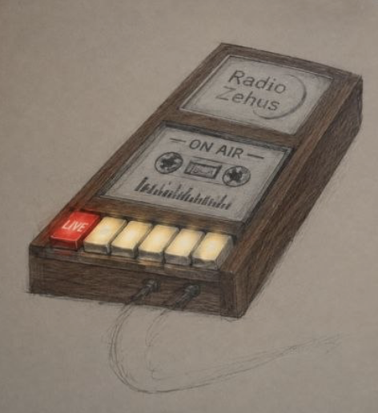
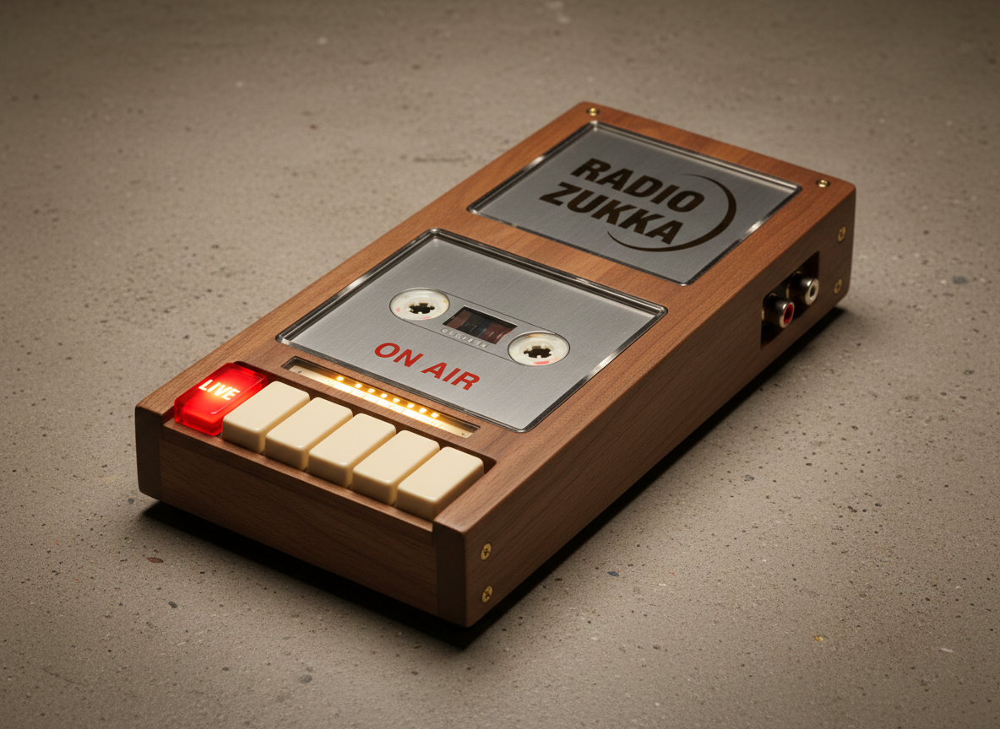
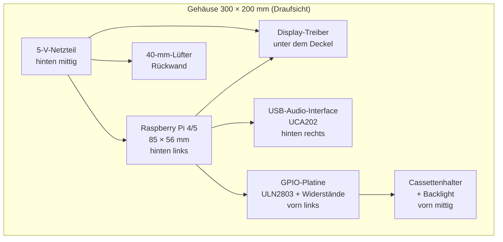

# Castcorder — realistischer Bauplan

Die Handskizze ist die Vorlage für ein Tischgerät im Stil eines späten
70er-/80er-Cassettendecks: Holzgehäuse, Cassettenfenster, VU-Skala,
Klaviertasten und ein roter LIVE-Taster. Dieses Dokument übersetzt die Skizze
in eine konkrete, baubare Konstruktion — mit Maßen, Stückliste, GPIO-Belegung
und einem phasenweisen Plan, der zur vorhandenen Software passt.

So sieht der realistische Aufbau aus, der aus der Skizze abgeleitet ist:

## 1. Was die Skizze vorgibt

| Skizzen-Element                     | Umsetzung im Bau                                                |
| ----------------------------------- | --------------------------------------------------------------- |
| Holzgehäuse mit sichtbarer Maserung | Nussbaum oder Birke, 12 mm Seitenwangen, geölt                  |
| Gekippte Oberseite                  | Keilform: 70 mm vorn, 100 mm hinten                             |
| Gerahmtes Feld „radio zukka“        | Phase 1: gravierte Messing-/Holzplakette; Phase 2: 3,5″-Display |
| Cassettenfenster mit zwei Spulen    | Echte Cassettenhülle ohne Band, warmweiß hinterleuchtet         |
| „ON AIR“-Schriftzug                 | Roter LED-Hinterleuchteter Schriftzug                           |
| VU-Skala mit Teilstrichen           | 7 bernsteinfarbene LEDs hinter Milchacryl + gedruckte Skala     |
| Fünf cremefarbene Klaviertasten     | Mechanische Tasten mit 3D-gedruckten Cream-Kappen               |
| Roter LIVE-Taster                   | 22-mm-Leuchttaster mit rotem LED-Ring                           |
| Zwei Kabel an der Front             | RCA L/R — im Bau nach hinten verlegt                            |

## 2. Zielmaße

| Maß                     | Wert          |
| ----------------------- | ------------- |
| Breite                  | 300 mm        |
| Tiefe                   | 200 mm        |
| Höhe vorn               | 70 mm         |
| Höhe hinten             | 100 mm        |
| Innenbreite             | 276 mm        |
| Innentiefe              | 188 mm        |
| Innenhöhe vorn / hinten | 58 mm / 88 mm |
| Wandstärke Seiten/Front | 12 mm         |
| Boden / Deckel          | 6 mm          |

Die Keilform gibt dem Deck die typische Cassettendeck-Silhouette und schafft
hinten genug Platz für Pi, USB-Audio-Interface und Netzteil. Vorn bleibt es
flach genug, dass die Klaviertasten ergonomisch erreichbar sind.

## 3. Zuschnitt

| Teil         | Maße                                  | Menge | Material            |
| ------------ | ------------------------------------- | ----- | ------------------- |
| Seitenwange  | 200 × 70/100 mm (Trapez), 12 mm stark | 2     | Nussbaum/Birke      |
| Boden        | 300 × 200 × 6 mm                      | 1     | Sperrholz/Multiplex |
| Front        | 300 × 70 × 12 mm                      | 1     | Nussbaum/Birke      |
| Rückwand     | 300 × 100 × 12 mm                     | 1     | Nussbaum/Birke      |
| Deckel       | 300 × 205 × 6 mm                      | 1     | Aluminium oder Holz |
| Leimklötze   | 20 × 20 × 40 mm                       | 8     | Restholz            |
| Tastenträger | 220 × 60 × 4 mm                       | 1     | 3D-Druck/Sperrholz  |

**Deckel-Ausschnitte**

| Ausschnitt       | Maß         | Position                                |
| ---------------- | ----------- | --------------------------------------- |
| Plakette/Display | 120 × 50 mm | mittig, 15 mm von der Rückkante         |
| Cassettenfenster | 140 × 80 mm | mittig, 10 mm unter der Plakette        |
| VU-Fenster       | 120 × 15 mm | mittig, 8 mm unter dem Cassettenfenster |
| ON-AIR-Fenster   | 40 × 10 mm  | rechts neben dem Cassettenfenster       |

**Front-Ausschnitte**

| Ausschnitt                 | Maß                         | Position                |
| -------------------------- | --------------------------- | ----------------------- |
| 5 Tastenschlitze           | je 38 × 22 mm, 4 mm Abstand | ab 70 mm von links      |
| LIVE-Taster                | Ø 22,5 mm                   | 30 mm von links, mittig |
| Kopfhörerbuchse (optional) | Ø 6,35 mm                   | rechts                  |

## 4. Innenaufbau

- **Pi** auf 5-mm-Abstandsbolzen, USB-Anschlüsse nach hinten.
- **UCA202** mit Klettband oder 3D-gedruckter Halterung, RCA-Buchsen nach hinten.
- **Netzteil** als 5-V-/3-A-Steckernetzteil mit DC-Hohlstecker; intern nur eine
  kleine 5-V-Verteilplatine mit Sicherung.
- **GPIO-Platine** mit ULN2803 für die VU-LEDs, Vorwiderständen für Taster-LED
  und ON-AIR-LED sowie Schraubklemmen.
- **Cassettenhalter** aus 3D-Druck, nimmt eine leere Cassettenhülle auf; zwei
  warmweiße LEDs hinterleuchten die Spulen.
- **Lüfter** optional; bei Pi 4/5 im Holzgehäuse empfohlen. Luft rein unten,
  raus hinten.

## 5. Stückliste

| Teil              | Empfehlung                                      | Menge | ca. Preis         |
| ----------------- | ----------------------------------------------- | ----- | ----------------- |
| Raspberry Pi      | Pi 4 Model B 2 GB oder Pi 5 4 GB                | 1     | 45–70 €           |
| USB-Audio         | Behringer UCA202/222                            | 1     | 30 €              |
| Netzteil          | 5 V / 3 A (Pi 5: 5 V / 5 A), DC-Hohlstecker     | 1     | 15 €              |
| Display (Phase 2) | 3,5″ HDMI/SPI, 480 × 320                        | 1     | 25 €              |
| LIVE-Taster       | 22-mm-Leuchttaster, rot, momentary              | 1     | 10–30 €           |
| Klaviertasten     | 5× mechanische Schalter + Cream-Kappen          | 5     | 10 €              |
| VU-LEDs           | 7× 5 mm bernsteinfarben, 2–3 mcd                | 7     | 3 €               |
| ON-AIR-LED        | 1× 5 mm rot                                     | 1     | 1 €               |
| Treiber           | ULN2803A + 8× 220–330 Ω                         | 1     | 3 €               |
| Cassettenhülle    | leere transparente Hülle                        | 1     | 2 €               |
| Acryl             | 2 mm Milchacryl für VU-Fenster                  | 1     | 5 €               |
| Holz              | Nussbaum/Birke, 12 mm; Multiplex 6 mm           | —     | 40–80 €           |
| Deckel            | Aluminium 1,5 mm, gebürstet                     | 1     | 20 €              |
| Kleinteile        | Messingschrauben, Füße, Kabel, Schrumpfschlauch | —     | 20 €              |
| Lüfter            | 40 mm, 5 V, mit Gitter                          | 1     | 8 €               |
| **Summe**         |                                                 |       | **ca. 220–310 €** |

## 6. Elektrik und GPIO

Die vorhandene Software nutzt bereits:

| Funktion    | BCM                      | Hinweis                     |
| ----------- | ------------------------ | --------------------------- |
| LIVE-Taster | 17                       | gegen GND, interner Pull-up |
| Taster-LED  | 27                       | rot, über Widerstand        |
| VU-Leiter   | 5, 6, 16, 22, 23, 24, 25 | 7 LEDs, links → rechts      |

Für die fünf Klaviertasten kommen freie Pins dazu (I2S 18–21 bleibt frei):

| Taste | BCM | Phase 1          | Phase 2          |
| ----- | --- | ---------------- | ---------------- |
| REW   | 4   | parallel zu LIVE | eigene Funktion  |
| PLAY  | 12  | parallel zu LIVE | Start/Stop       |
| STOP  | 13  | parallel zu LIVE | Stop             |
| FF    | 26  | parallel zu LIVE | eigene Funktion  |
| REC   | 11  | parallel zu LIVE | Start mit Ansage |

Weitere Pins:

| Funktion            | BCM | Hinweis                     |
| ------------------- | --- | --------------------------- |
| ON-AIR-LED          | 8   | über Transistor             |
| Cassetten-Backlight | 9   | PWM über MOSFET             |
| Lüfter              | 10  | über MOSFET oder direkt 5 V |

**Phase 1 ohne Softwareänderung:** Alle fünf Tasten werden über 1N4148-Dioden
auf den LIVE-Eingang (BCM17) gelegt. Jede Taste löst damit denselben
Start/Stop aus. Das ist die einfachste baubare Variante und funktioniert mit
der aktuellen Software.

**Phase 2 mit Softwareänderung:** Jede Taste bekommt einen eigenen GPIO. Dafür
muss `castcorder/hardware.py` um eine Tastenmatrix und `castcorder/app.py` um
die Transportlogik erweitert werden. Die Konfiguration kann die Pins unter
`[gpio]` aufnehmen.

## 7. Bauablauf

1. **Mockup:** Gehäuse aus Karton im Maßstab 1:1 bauen, Pi und UCA202 einlegen,
   Tastenposition prüfen.
2. **Holzarbeiten:** Seitenwangen trapezförmig zuschneiden, Front/Rückwand und
   Boden zusägen, Ausschnitte fräsen. Alles trocken zusammenstecken.
3. **Deckel:** Aluminiumplatte bohren/fräsen, entgraten, mit Scotch-Brite
   bürsten. Alternativ Holzdeckel mit Acrylfenstern.
4. **Elektronik auf dem Tisch:** Pi, UCA202, LEDs, Taster und Netzteil zuerst
   fliegend verdrahten und mit `--no-gpio` bzw. `--check` testen.
5. **Software:** `deploy/install.sh`, `config.toml` und `streamer.env`
   einrichten; LIVE-Taster und VU-Leiter prüfen.
6. **Einbau:** Komponenten auf Trägerplatten montieren, Kabel mit Klebesockeln
   führen, Zugentlastung an der Rückwand.
7. **Finish:** Holz mit Hartwachsöl behandeln, Messingteile polieren, Füße
   montieren.
8. **Test:** 30 Minuten Dauerstream, Temperatur prüfen, Audiopegel und
   Brummfreiheit kontrollieren.

## 8. Risiken und Gegenmaßnahmen

| Risiko                               | Gegenmaßnahme                                                  |
| ------------------------------------ | -------------------------------------------------------------- |
| Wärmestau im Holzgehäuse             | Lüftungsschlitze unten/hinten, 40-mm-Lüfter, Pi mit Kühlkörper |
| Brummen/Einstreuung                  | geschirmte RCA-Kabel, getrennte LED-Versorgung, Ferritperlen   |
| Tastenprellen                        | Software-Debounce (bereits vorhanden), RC-Filter optional      |
| Holz arbeitet                        | Boden als Multiplex, Deckel schwimmend verschraubt             |
| Display passt nicht unter den Deckel | Displaytreiber flach montieren, Flachbandkabel seitlich führen |
| LIVE-Taster zu hoch                  | flachen 22-mm-Taster wählen, Innentiefe prüfen                 |

## 9. Realistische Varianten

| Variante               | Aufwand         | Ergebnis                                                                 |
| ---------------------- | --------------- | ------------------------------------------------------------------------ |
| **Werkstatt-Prototyp** | 1 Wochenende    | Multiplex-Gehäuse, Acrylfenster, 5 Tasten parallel zu LIVE               |
| **Wohnzimmer-Deck**    | 2–3 Wochenenden | Nussbaum, Aluminiumdeckel, hinterleuchtete Cassette, saubere Verkabelung |
| **Deluxe**             | 4+ Wochenenden  | Analog-VU-Meter, motorisierte Spulen, Display mit Track-Info             |

Für den ersten Bau würde ich die **Wohnzimmer-Deck-Variante** empfehlen: Sie
sieht der Skizze am nächsten, bleibt mit handelsüblichen Werkzeugen baubar und
funktioniert mit der aktuellen Software ohne Änderungen.
